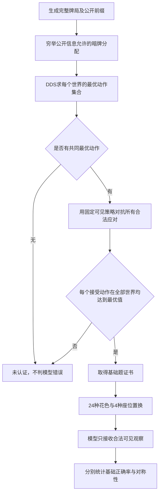

# 基础出牌能力与花色一致性检测 v1

日期：2026-10-26。入口：`python -m bridgemind.foundation`。这是一套可生成题目、验证答案、评估任意出牌检查点、输出分项与对称性报告的开发体检系统，与随机0/全知DDS100的[对战牌力评分器](cardplay-rating.md)并行维护。

**优先检测公开信息下可明确证明的基础选择，分别报告“是否答对”和“花色改变后是否一致”。** 一致地犯错不能得到基础能力高分；随机策略的概率分布可以完全不依赖花色，但并不代表会打牌。

## 1. 覆盖范围

| 类型 | 检测内容 | 是否计入基础宏平均 |
|---|---|---|
| 及时拿墩与保先手 | 应用A盖K，保护后续兑现机会 | 是 |
| 第四家拿墩 | 对手当前赢墩时，选择可明确证明更好的拿墩牌 | 是 |
| 保留搭档进手 | 不用自己的A无谓盖住搭档已有的赢牌 | 是 |
| 最小足够赢牌 | 用Q即可赢时，保留A处理后续高牌 | 是 |
| 先兑现确定赢张 | 先兑现已知大牌，再处理较小牌 | 是 |
| 垫掉输张 | 当前不能赢时，保留后续确定赢张 | 是 |
| 用小将牌将吃 | 以足够的小将牌赢墩，并保留大将牌 | 是 |
| 正确超将吃 | 识别已有将牌及大小，避免欠将吃或错误垫牌 | 是 |
| 等价多答案控制 | A/K均正确时，两个都接受 | 否，避免送分题抬高能力成绩 |
| 强制跟牌控制 | 仅有一张合法跟牌，验证接口与规则约束 | 否，合法掩码不等于学会了跟牌 |

每类扩展庄家本人、明手控制、防守三种角色；用三个固定种子变换低张等级和合法历史。每个可用位置再覆盖**全部24种花色双射 × 4种座位轮换**。有将牌局连同将牌花色一起置换，不能只换手牌而漏掉定约或历史。

初版基于2～4墩残局嵌入完整52张牌、合法叫牌与合法历史。它具备完整检测流程和扩展接口，并不穷尽桥牌知识；飞牌、忍让中的概率权衡、复杂交通、挤牌、信号及叫牌不在当前已认证覆盖范围内。

## 2. 答案如何取得证书

不能把某一副真实暗牌的DDS最优牌，直接当成模型必须知道的答案。也不能在每个暗牌世界里各挑一条全知续打路线，就声称存在不看暗牌的共同策略。

本系统对每个基础位置实施两重检查：

1. **所有可行暗牌世界的一致最优。** 穷举满足本人/明手可见牌、剩余张数、已出牌和公开缺门的暗牌分配。每个被接受动作都须在全部世界中达到DDS最优剩余得墩。存在多个等价最优动作时全部接受。
2. **可执行的可见信息续打证据。** 对每个被接受动作，寻找一个固定的公共续打策略。在每个暗牌世界中，让本方后续只能依据各自合法可见信息执行这个策略；对手则可以全知并穷举所有合法应对。只有该策略始终达到上述DDS值，动作才取得证书。



当前续打证据库包含 `rule-basic` 和 `cash-public-master`。后者只根据已知牌与公开出牌寻找确定赢张，其他时候回退基础规则；它不能访问真实暗牌分配。证据库有限意味着验证**保守且非穷尽**：未找到证据不是说题目一定无解，只是不据此判错。

对已认证基础题，花色/座位变体的证书由完整游戏同构传递：先将公共观察反变换回规范坐标，执行规范续打策略，再将动作变换回来。发牌、手牌、历史、合法掩码、将牌、局况、得墩归属、庄家/明手及角色全部同步变换。每个实例保留证书和具体变换，能重放检查。

防守续打时，每个防守者只看到其本人手牌和明手，不把搭档手牌偷偷共享。对手的全知与完全应对枚举仅用于验证下界；DDS给出上界，二者相等才认证。这解决了仅按采样DDS一致意见贴标签可能存在的策略融合问题。

## 3. 第一版题库的实际覆盖

- 候选基础位置90个：10类 × 3角色 × 3固定种子。
- 已认证战术位置66个。
- 多答案控制9个、强制跟牌控制9个。
- 另6个未认证：3个防守位置没有共同最优动作，3个只有全知一致性、未找到公共续打证据。它们保留原因，但不计入成绩。
- 共84个可评位置，展开为**8064个变体**。其中6336个战术变体计入基础宏平均，1728个控制变体单独报告。

保留搭档进手、最小足够赢牌两类在防守角色下的认证覆盖不同，所以角色分数不能简单解释为同一组题的能力排名。每份题库与报告保留逐类、逐角色覆盖，不能用没有认证的题补齐分母。

这些是模板、低张、历史和角色的相关变体，不能说是8064副独立测试牌，也不对它们套用独立牌局置信区间。当前题库是开发回归集；未来泛化验证需另留新结构、新模板的测试，而非把同题的换花色版本随机分到训练与测试两侧。

## 4. 指标定义

| 指标 | 定义及含义 |
|---|---|
| 原始花色基础正确率 | 规范CDHS、原座位下，8项战术正确率的等权宏平均 |
| 全花色基础正确率 | 所有24种花色、4种座位变体下，8项战术正确率等权宏平均 |
| 最差花色正确率 | 对相同基础位置，取24种完整花色置换中的最低宏平均 |
| 花色差距 | 最好置换减最差置换，百分点；越小越稳定 |
| 花色分布一致性 | 将动作概率反映射到规范坐标，计算相对原始花色的平均总变差距离TV，报告 `100 × (1 - mean TV)` |
| 严格选牌一致性 | 反映射后与原始花色选择同一张牌的比例；与能力正确率分开解释 |
| 全部花色均答对的位置比例 | 对每个基础位置和座位组，24种花色全部通过的比例 |
| 座位一致性 | 相同牌局/花色经过四种座位轮换，反映射动作相同的比例 |
| 合法动作比例 | 实际返回动作是否合法；仅反映接口规则，不当作战术能力 |

对等价正确动作，选哪个都算答对；严格选牌一致性仍可能不同，因此不能直接用该一致性指标判模型战术错误。分布一致性还可以发现“最高概率牌相同，但概率随花色大幅漂移”的情况。

基础能力百分比不使用随机0/全知DDS100的标尺。均匀随机在这套少选项题上正确率约45%，概率分布的花色一致性却是100%；必须同时看正确率、最差花色和全部花色通过率。

## 5. 已实测六个策略

| 策略 | 原始花色基础正确率 | 全花色基础正确率 | 最差花色 | 概率分布一致性 | 全部花色均答对的位置 |
|---|---:|---:|---:|---:|---:|
| 公共赢张规则 `public-master` | 100.00% | 100.00% | 100.00% | 100.00% | 100.00% |
| 基础规则 `rule-basic` | 87.50% | 87.50% | 87.50% | 100.00% | 86.36% |
| 旧SL `sl-pilot` | 72.22% | 71.88% | 59.72% | 88.20% | 43.94% |
| 旧PPO `ppo-pilot-last` | 72.22% | 71.67% | 59.72% | 88.71% | 45.45% |
| 长训SL `sl-long-42` | 61.81% | **57.93%** | **48.61%** | **82.90%** | **16.67%** |
| 随机 | 47.92% | 45.80% | 39.76% | 100.00% | 0.00% |

`public-master` 是一组可见规则，不是全知DDS，也没有通过定义被指定100；它在本轮已认证题中实测全部答对。基础规则只达到87.5%，主要因为“最长非将花色出小牌”会在应先兑现大牌的题中出错；规则策略也不是判题真值。

长训SL的分项结果（全变体）：

| 能力 | 正确率 |
|---|---:|
| 及时拿墩与保先手 | 52.31% |
| 第四家拿墩 | 62.50% |
| 保留搭档进手 | 93.75% |
| 最小足够赢牌 | 50.69% |
| 先兑现确定赢张 | 49.07% |
| 垫掉输张、保留赢张 | 94.44% |
| 用小将牌将吃 | **32.41%** |
| 正确超将吃 | **28.24%** |

最好与最差花色置换相差**24.31个百分点**。座位轮换选牌一致性为100%，说明本轮明显不一致主要出现在花色变换，而非整桌座位平移。全量合法动作100%和强制跟牌100%由接口合法约束支持，不能据此认为模型已掌握基础战术。

旧SL在这些构造基础题上高于长训SL，与长训模型在完整对战中优于旧模型可以同时成立。这个结果支持将基础能力单独纳入训练验收，但不说明旧SL整体桥牌水平更强，也不能由有限的合成模板推断真实牌局总体失误率。

完整结果、每个接受动作的公共续打证据及代表性失败牌局见 [artifacts/cardplay-foundations-v1](../artifacts/cardplay-foundations-v1/report.md)。完整8064条逐变体概率和选择保存在本机 `runs/cardplay-foundations-v1/predictions/`；导出报告保留其SHA256。

## 6. 日常使用

2026-10-26追加SL v2：全花色和最差花色基础正确率均100%，概率分布一致性99.924%，所有花色选牌及座位轮换选牌一致率100%，8,064变体全答对。课程使用同题型的新种子，该体检是未重复完整发牌的开发回归；完整实战泛化另由全新2,048副真实牌确认。详见 [SL v2验收](cardplay-sl-v2-evaluation.md)，原六策略历史成绩保留。

当前机器已经有认证题库，新检查点直接运行，无需DDS服务：

```powershell
.\.venv\Scripts\python.exe -m bridgemind.foundation evaluate --id candidate-001 --model runs/new-model/best.pt
.\.venv\Scripts\python.exe -m bridgemind.foundation export
```

每个模型用独立ID；同一ID下权重、配置或逐变体缓存不同会被拒绝。匹配的已有评估直接复用缓存。题库绑定实现、Python、OpenSpiel、NumPy和PyTorch版本；升级后使用原环境，或建立新版本，不能静默混合结果。

在另一台已配置匹配环境的机器上，可直接安装仓库中的认证题库，不需要重求DDS，也不依赖本机忽略的训练数据：

```powershell
# 目标目录须尚不存在；只安装题目和证书，不复制旧预测缓存
.\.venv\Scripts\python.exe -m bridgemind.foundation --root runs/my-foundations install --source artifacts/cardplay-foundations-v1
.\.venv\Scripts\python.exe -m bridgemind.foundation --root runs/my-foundations evaluate --id candidate-001 --model runs/new-model/best.pt
```

重新生成新种子/版本的题库时才需要独立DDS服务：

```powershell
# 在另一个终端启动；已有服务时无需重复启动
.\.venv\Scripts\python.exe -m bridgemind.dds.server --workers 4 --port 18765

.\.venv\Scripts\python.exe -m bridgemind.foundation --root runs/cardplay-foundations-v2 build --name cardplay-foundations-v2 --seeds 2101 2111 2129
```

增加基础技能时，在 `foundation/cases.py` 添加残局模板。生成器验证完整52张牌、合法历史和角色；若没有跨全部暗牌世界的共同最优及可见续打证据，新模板不能进入战术评分。可在 `foundation/certificates.py` 增加只使用合法可见观察的续打策略以扩大可认证覆盖。每次修改需生成新版本，并运行原生DDS、信息隔离及全变换测试。

## 7. 验证与范围

新增47项测试覆盖：10类×3角色的合法完整牌；无将与有将的24花色×4座位完整重放同构；每个接受动作的公共续打上下界；暗牌交换不改变证据策略观察；多答案全部接受；未认证题不评分；一致地犯错仍为0分；概率变化与argmax变化分开统计；控制题不抬高宏平均；题库/记录改动拒绝及离线安装。

模型只收到合法可见观察，不收到题型、标签或真实暗牌；策略可见请求ID也使用不可读的哈希，不能从题型名称猜答案。

本轮全量pytest **257项通过，22.65秒**。结果绑定原模型SHA256，评分器v1实现和全部原权重未修改。构建时使用独立DDS v3.1.0服务；本轮创建的专用服务在完成证明后已清理，后续模型推理和离线安装不需要DDS。全量回归与独立重算记录见 [verification.json](../artifacts/cardplay-foundations-v1/verification.json)。
