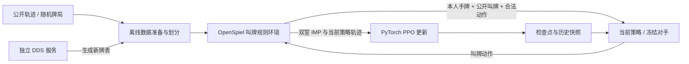

# 叫牌训练与推理

当前实现的是叫牌策略训练：监督学习热启动、基于双室 IMP 的 PPO、自对弈历史池、断点续训与评估。出牌策略尚未进入训练。模型只接收本人手牌和公开信息；完整牌与 DDS 表留在环境中，用于定约结算。

## 架构与数据流



OpenSpiel 直接嵌入 rollout 进程；无需另起 OpenSpiel 服务。DDS 仍可独立运行。使用预计算牌表训练时，每次叫牌结束直接查表，不重复求解，也无需启动 DDS。生成新牌库时，`generate-boards` 通过 TCP 把完整牌发给 DDS 服务，其并发由已有调度器负责。

## 环境

已有 `.venv` 可直接使用。当前机器：Python 3.13、OpenSpiel 2.0.2 Windows wheel、PyTorch 2.11.0+cu128，RTX 5070 12 GB，CUDA 已验证可用。依赖快照在 `requirements-dev.lock.txt`。

新建 Windows 环境：

```powershell
python -m venv .venv
.\.venv\Scripts\python.exe -m pip install torch==2.11.0 --index-url https://download.pytorch.org/whl/cu128
.\.venv\Scripts\python.exe -m pip install -e '.[dev,train]'
```

CPU 环境可直接安装 `.[dev,train]`，训练加 `--device cpu`。CUDA wheel 必须匹配实际硬件；上述命令记录本机通过验证的组合。训练默认 `--device auto`，GPU 用于批量更新，rollout 使用 CPU 冻结副本。CPU 默认单线程，避免小批量 MLP 的线程调度开销。

## 已准备的数据

| 数据 | 训练 | 验证 | 测试 |
|---|---:|---:|---:|
| DDS 牌表 | 100,000 副 | 10,000 副 | 20,000 副 |
| WBridge5 监督牌局 | 100,000 副 | 10,000 副 | 10,000 副 |
| 监督叫牌决策 | 1,106,954 条 | 110,853 条 | 110,497 条 |

六个本地集合已按完整发牌的 SHA256 检查，互不重叠。同一副牌换庄家、换局况仍视为同一副，不能跨集合。训练器启动时也会检查所用训练与验证集合是否重叠。测试集没有用于本轮调参和效果评估。

DDS 数据来自 [Pgx 公共牌表](https://huggingface.co/datasets/sotetsuk/dds_dataset)，从 250 万副中固定随机抽样，随机化庄家及双方局况。32 副完整牌表已用本地 DDS v3.1.0 重算，20 个单元格全部一致。其余公开表没有全部重算，不能标记为由当前 DDS 生成。来源与哈希记录在 `data/sources.json`、`data/boards/manifest.json`。

监督轨迹来自 [OpenSpiel bridge 数据目录](https://storage.googleapis.com/openspiel-data/bridge/README.txt)，由 WBridge5 使用 SAYC 生成，原始设置全部是北家发牌、双方无局。`prepare-sl` 保留这些真实条件，不把标签强行扩展到其他局况。RL 数据涵盖全部庄家与局况。导入会验证叫牌合法性与回合完整性，并用 packbits 压缩观察和合法动作掩码。

下载与重建：

```powershell
.\.venv\Scripts\python.exe -m bridgemind.training fetch
.\.venv\Scripts\python.exe -m bridgemind.training prepare-boards
.\.venv\Scripts\python.exe -m bridgemind.training prepare-sl
.\.venv\Scripts\python.exe -m bridgemind.training audit
```

首次下载约 477 MB 原始数据，另有约 15 MB 公开模型及转换后的模型。`fetch` 校验固定 SHA256。`prepare-boards` 默认验证 32 副新 DDS 结果，要求本地原生库可用；`--verify 0` 可显式关闭。已有牌表目录不会覆盖；重建使用新的 `--output`。监督导入已有完整集合时会核查数量、来源和重叠情况并复用；中断产生的未完成目录应改用新的输出路径。

可选：完全使用自己的 DDS 服务生成新牌表，替代公开牌表：

```powershell
# 终端一
.\.venv\Scripts\python.exe -m bridgemind.dds.server --workers 8 --port 18765
# 终端二，三个数量依次为训练、验证、测试
.\.venv\Scripts\python.exe -m bridgemind.training generate-boards --output data/fresh-boards --sizes 1000 100 100 --port 18765
```

该命令对每副随机牌只求解一次完整表，记录服务的求解器版本。已用真实独立进程生成 16 副牌并完成 8/4/4 划分。若后续加入已有实验，应再次审计各数据集交集；不同命令采用同一随机种子生成的牌不能当成不同集合。

## 观察、模型与公开初始权重

480 维输入与 [brl](https://github.com/harukaki/brl) / [Pgx 定义](https://github.com/sotetsuk/pgx/blob/main/docs/bridge_bidding.md) 对齐：4 维局况、4 维首次实叫前的 Pass、35×12 维叫牌/加倍/再加倍记录、52 维自己的牌。历史中的座位相对当前行动者排列；模型输出 38 个动作 logits，另外有独立的 value 输出。所有推理和训练都应用合法动作掩码。合法动作编号与现有环境一致，P=0、X=1、XX=2、1C=3 … 7NT=37。

网络是四层 1024 单元 ReLU MLP，共享主干，actor 输出 38，critic 输出 1。`--hidden-size` 支持从零开始训练较小模型；加载检查点时以检查点的网络规模为准。

本机 OpenSpiel 2.0.2 wheel 在非北家发牌时，其原生观察中的叫牌人位置缺少庄家偏移。训练编码器从显式的公开历史和本人手牌重建特征，避免直接截取原生 tensor。测试覆盖北家编码对照与座位旋转一致性；上游源码和 wheel 均未修改。`BridgeBiddingEnv.observation()` 保留原始 tensor，并额外提供合法的 `hand`、`dealer`、`vulnerable` 字段。

公开模型固定到 brl 提交 `fdd958ff8adcb44844d70ea2e233bed18d5a7b70` 的监督权重。导入先验证 Git blob 哈希，再通过只允许指定 NumPy 重建入口的读取器转换，**不安装或执行 JAX**。PyTorch 权重与原始数组的 NumPy 前向结果已核对。项目检查点用 `torch.load(weights_only=True)` 读取。

公开模型及借鉴的编码/架构遵循 Apache-2.0，署名和许可证见 `third_party/licenses/README.md`。本地数据审计只能证明本次划分的独立性，无法审计公开预训练模型的全部训练历史。

## 训练

先热启动监督学习：

```powershell
.\.venv\Scripts\python.exe -m bridgemind.training train-sl --run runs/sl-main --init data/baselines/brl-sl.pt --steps 1000 --device auto
```

随后 PPO：

```powershell
.\.venv\Scripts\python.exe -m bridgemind.training train-ppo --run runs/ppo-main --init runs/sl-main/last.pt --updates 100 --boards-per-update 128 --device auto
```

这里的步数只是可调整的首轮实验配置，不能视为收敛标准。训练过程：

1. 同一副牌开两室。A 室当前模型打南北、对手打东西；B 室双方交换位置，庄家和局况保持相同。每副牌两室使用相同冻结对手。
2. 计算 `IMP(A室南北原始分 - B室南北原始分)`，缩放为 `/24`。这是当前模型的队伍收益，其在两室的全部决策共享此收益，不能按每个行动座位再反转符号。
3. 完整叫牌结束后才更新；γ=1，用最终双室收益做 Monte Carlo return。PPO 使用标准化优势、clip=0.2、熵奖励、价值损失、梯度裁剪和 KL 提前停止。无需把固定对手的动作加入 PPO buffer。
4. 对手槽位按 50% 最近快照、25% 历史快照、25% 初始锚点抽样。每批先抽一个历史快照，再逐副牌抽槽位。早期历史不足时复用初始快照。快照默认每 5 次更新保存，活跃历史最多 8 个。
5. 默认每 5 次更新用固定验证牌评估锚点对手，采用贪心叫牌，报告每副 IMP 和按完整双室牌局重采样的 bootstrap 95% 区间。

首次 PPO 会将 critic 置零，因为监督模型的价值头不对应当前 IMP 目标。续训保留价值头。这里采用单一共享策略，双方搭档使用同一模型；人机搭档体系和专门的搭档适配尚未加入。

每个 run 保存 `last.pt`、`metrics.jsonl`，PPO 另外保存 `league/`。检查点包含网络、优化器、NumPy/PyTorch/CUDA 随机状态、数据指纹、配置和软件/Git 版本。续训时校验配置与数据，拒绝混用。

```powershell
# 保持原来的训练参数；updates 是累计目标，不是额外轮数
.\.venv\Scripts\python.exe -m bridgemind.training train-ppo --run runs/ppo-main --resume --updates 200 --boards-per-update 128 --device auto
```

如果首次运行修改过学习率、评估数量、快照间隔等参数，续训时也要传入相同值。SL 在评估间隔保存，PPO 每次完整更新保存。历史快照文件保留在磁盘，活跃池大小限制的是采样池；长期训练可归档整个实验目录。恢复测试已在 CPU 上验证“连续两轮”与“一轮后恢复再一轮”的模型参数逐位相同。跨硬件或 CUDA 算子不保证逐位相同。

## 评估与游戏侧调用

```powershell
.\.venv\Scripts\python.exe -m bridgemind.training evaluate --model runs/ppo-main/last.pt --opponent data/baselines/brl-sl.pt --boards data/boards/valid.npz --count 10000 --output runs/ppo-main/validation.json
```

评估需要同时说明对手、牌库和样本量，不能把自对弈训练收益当成绝对棋力。训练过程中用 valid；最终选好配置后才显式使用 `test.npz`。测试集没有自动进入训练日志。

游戏服务器可直接加载检查点：

```python
from bridgemind.training.policy import BiddingPolicy

policy = BiddingPolicy("runs/ppo-main/last.pt", device="cpu")
decision = policy.predict(env.observation())
env.apply_call(decision["call_id"])
```

返回包含 `state_id`、动作编号、叫法和合法动作概率，便于调用方核对当前局面。该接口不启动训练，也不访问其他玩家手牌。

## 本轮验证与后续重点

本轮已在真实数据上完成 300 次监督更新、10 次 PPO 更新，其中 PPO 从第 8 次检查点恢复到第 10 次。具体报告见 `artifacts/training/pilot-report.json` 和 `docs/training-validation.md`。这是训练流程验证，尚无足够证据称模型棋力提高，更不能称其为最强桥牌 AI。

接下来应先用多个种子、更多训练牌与固定对手面板做稳定性实验，按验证 IMP 选择检查点，并保留公开初始模型作为对照。当前 DDS 假设各方全知且完美出牌，只提供叫牌训练的近似结算目标；实际游戏中的出牌能力必须单独训练和评估。
